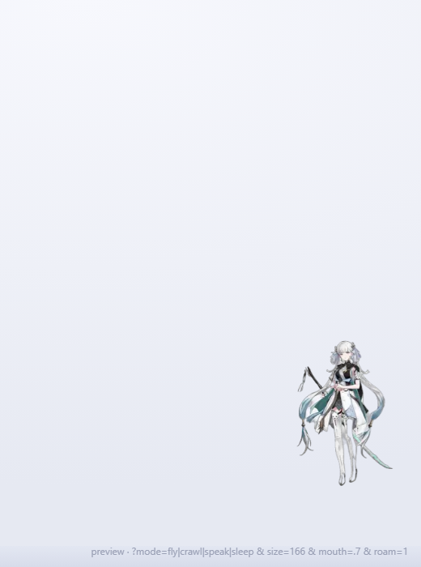

# dsh-jinhsi-avatar

DSH 窗口右下角常驻的**今汐**形象体（《鸣潮》同人）：会自己在窗口里走动、靠近时变大、点击有敲碗音效并随口报余额与今日花费。



## 特性

- **四组动作**：待机 / 行走 / 飞行 / 打盹，全部由官方立绘经图生视频生成，逐帧抠图成透明循环动画，没有背景残留
- **忙碌时不乱跑**：每 2 秒轮询宿主状态；只要有会话正在跑回合，她就飞回右下角、保持默认档静止；全部会话空闲后才继续随机走动
- **自动漫游**：在对话区里自己挑落点，每次移动至少 1/3 界面；先判断"这个方向走不走得够"再选点；落点即下一段起点，不会瞬移
- **远近变化**：往上走一档放大、往下走一档缩小；尺寸过渡的时长与本次移动距离挂钩，动作和尺寸同时开始、同时结束
- **回窝**：双击平滑飞回右下角并缩回第 2 档（不会瞬移）
- **点击回应**：五个音随机播放的敲碗音（1046 / 1175 / 1319 / 1568 / 1760 Hz），气泡随机说一句台词或报账
- **报账**：读取本机鲸鱼余额挂件账本（`~/.dsh/.dshw-usage.json` 的 `lastBalance` 与 `todayUsage`），按 ×10 显示为「余额 67 星声 · 今日 26 星声」

## 宿主接口

插件服务端注册了一个只读接口：

```
GET /dsh-avatar/state
{ "busy": false, "running": 0, "cny": 6.68, "stars": 67, "todayCny": 2.60, "todayStars": 26 }
```

`busy` 由 `turn/start` / `turn/end` 事件维护；余额与今日花费来自鲸鱼余额挂件的账本文件。

## 安装

从 GitHub 安装：

```bash
dsh plugin add github:ten-feng/dsh-jinhsi-avatar
```

或写进 profile 的 `package.json`（两处都要）：

```jsonc
"dependencies": { "dsh-jinhsi-avatar": "github:ten-feng/dsh-jinhsi-avatar" },
"dsh": { "profile": { "bundles": [ ..., "dsh-jinhsi-avatar" ] } }
```

装完重启 DSH。npm 包暂未发布。

## 交互

| 操作 | 行为 |
|---|---|
| 单击 | 播放敲碗音 + 气泡（台词或余额/今日花费） |
| 拖动 | 跟随鼠标移动，松手后停一会儿再继续逛 |
| 双击 | 平滑飞回右下角，尺寸回到第 2 档 |

## 已知边界

- 立绘裁切后是 168×243 的循环动画，浏览器端按 CSS 缩放；「大」档会比源素材放大，边缘略软
- 报账依赖鲸鱼余额挂件的账本文件；没装或没数据时气泡只说话、不报数
- 忙碌判定按「有回合在跑」；如果你在某个会话里长时间空跑，她那段时间不会漫游
- 动画素材为图生视频产出，人物细节与官方立绘可能有轻微漂移

## 许可

MIT。角色形象版权归《鸣潮》/ Kuro Games 所有，本项目仅作个人桌面使用。
